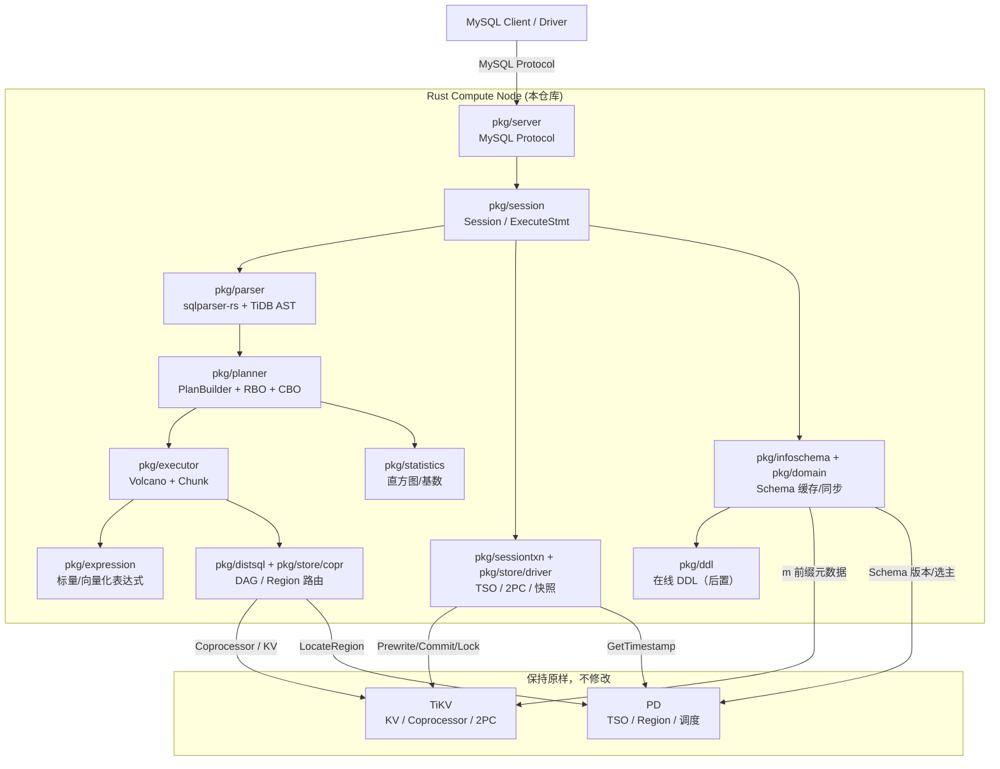
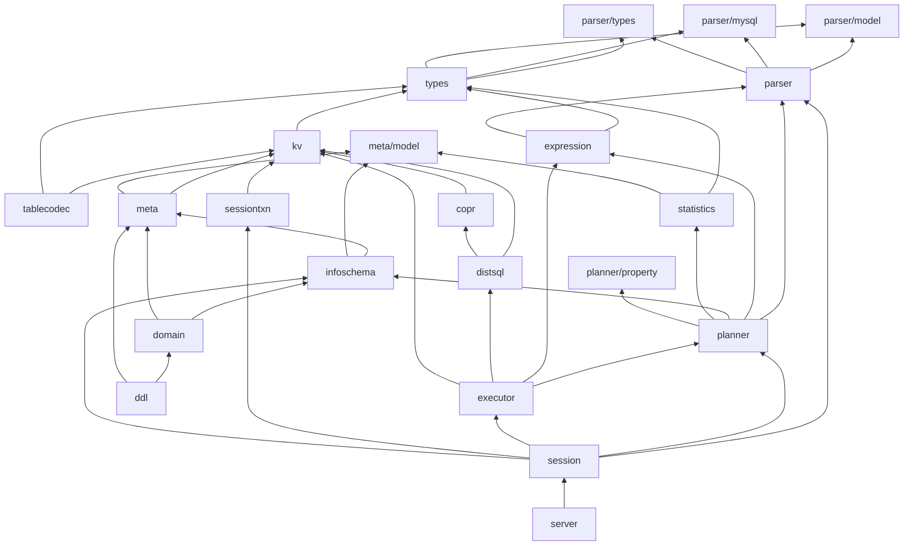

# 目标架构（Architecture）

> 状态：**v0.1 初稿**  
> 上游基线：TiDB **v8.5.8**  
> 本文定义“长什么样、如何分层、目录如何对齐”。具体阶段见 [roadmap.md](./roadmap.md)。

---

## 1. 总体架构



### 1.1 分层铁律

```text
Protocol → Session → Parser → Preprocess → Planner(RBO→CBO) → Executor → DistSQL/KV → TiKV
                                      ↑                         ↑
                                  InfoSchema/Statistics      Transaction/Snapshot
```

- **Parser 不做语义分析**；名字解析在 Preprocess/PlanBuilder。
- **Planner 不直接发 RPC**；通过 Executor/Build 后的 Reader 发。
- **Executor 不直接拼 TiKV 原始请求**；通过 `pkg/distsql` / `pkg/store`。
- **PD/TiKV 只通过 `pkg/store` 访问**；其他层禁止直连。

---

## 2. 仓库布局（单 crate 优先）

### 2.1 结论

**Phase 0 采用单 crate + `pkg/` 模块树**，最大限度保持目录/文件与 TiDB 一致，降低 20+ 个 `Cargo.toml` 与跨 crate 可见性带来的维护成本。  
当编译时间或边界管理成为瓶颈时，再按 ADR 拆分 workspace（见 ADR-0002）。

```text
sealdb/
├── Cargo.toml                 # [lib] path = "pkg/lib.rs"
│                              # [[bin]] name = "tidb-server", path = "cmd/tidb-server/main.rs"
├── rust-toolchain.toml        # 固定工具链
├── pkg/
│   ├── lib.rs                 # 顶层模块声明（Rust 必需，额外文件）
│   ├── parser/                # 对应 pkg/parser
│   │   ├── mod.rs             # Rust 模块根（额外文件）
│   │   ├── parser.rs          # ← parser.go（对外 API / ParseSQL）
│   │   ├── lexer.rs           # ← lexer.go（薄封装/兼容层）
│   │   ├── ast/               # ← pkg/parser/ast/*
│   │   ├── model/             # ← pkg/parser/model/*
│   │   ├── mysql/             # ← pkg/parser/mysql/*
│   │   ├── types/             # ← pkg/parser/types/*
│   │   ├── format/            # ← pkg/parser/format/*
│   │   ├── opcode/            # ← pkg/parser/opcode/*
│   │   ├── terror/            # ← pkg/parser/terror/*
│   │   ├── charset/           # ← pkg/parser/charset/*
│   │   ├── sqlparser_bridge/  # ★ 额外：TiDBDialect + AST lowering
│   │   │   ├── mod.rs
│   │   │   ├── dialect.rs
│   │   │   └── lower.rs
│   │   ├── parser.y           # 保留文件名；仅参考注释，不参与编译
│   │   └── hintparser.y       # 同上
│   ├── types/                 # ← pkg/types
│   ├── kv/                    # ← pkg/kv
│   ├── meta/                  # ← pkg/meta
│   ├── infoschema/            # ← pkg/infoschema
│   ├── domain/                # ← pkg/domain
│   ├── expression/            # ← pkg/expression
│   ├── planner/               # ← pkg/planner（core/、property/、cascades/ ...）
│   ├── executor/              # ← pkg/executor（internal/、join/、aggregate/ ...）
│   ├── session/               # ← pkg/session
│   ├── sessionctx/            # ← pkg/sessionctx
│   ├── sessiontxn/            # ← pkg/sessiontxn
│   ├── store/                 # ← pkg/store（driver/、copr/）
│   ├── distsql/               # ← pkg/distsql
│   ├── ddl/                   # ← pkg/ddl
│   ├── statistics/            # ← pkg/statistics
│   ├── privilege/             # ← pkg/privilege
│   ├── bindinfo/              # ← pkg/bindinfo
│   ├── config/                # ← pkg/config
│   ├── table/                 # ← pkg/table
│   ├── tablecodec/            # ← pkg/tablecodec
│   ├── errno/                 # ← pkg/errno
│   └── util/                  # ← pkg/util（chunk/、codec/ ...）
├── cmd/tidb-server/main.rs    # ← cmd/tidb-server/main.go
├── tools/oracle/              # ★ 额外：Go Oracle（不参与 parity）
├── tests/                     # Rust 集成/一致性测试
├── testdata/                  # 金样/语料
├── docker/                    # 复用并固定版本
├── monitoring/                # 复用
├── config/                    # 复用并重写
└── project/                   # 本工程手册
```

### 2.2 目录/文件对齐规则

| 规则 | 说明 |
|---|---|
| R1 | TiDB 的目录在 Rust 中同名存在；计算层目录必须完整。 |
| R2 | `foo.go` → `foo.rs`，路径相对 `pkg/` 保持一致。 |
| R3 | 每个目录必须有 `mod.rs`（Rust 模块根）；顶层 `pkg/lib.rs` 声明模块。 |
| R4 | `*_test.go` 默认内联为 `#[cfg(test)] mod tests`；需要独立文件时用 `foo_test.rs` 并在 `mod.rs` 注册。 |
| R5 | TiDB 的生成文件（`parser.go`、`*_generated.go`）若在 Rust 中不生成，则对应 `.rs` 作为**手写替代**，状态标 `reimplemented`。 |
| R6 | `.y`、`.toml`、`.json`、`.md`、testdata 等非 Rust 文件：保留文件名；不参与编译；必要时放只读参考副本或说明文件。 |
| R7 | 构建文件 `Cargo.toml`、`Cargo.lock`、`rust-toolchain.toml`、`mod.rs`、`lib.rs` 属于**允许的额外文件**。 |
| R8 | `tools/`、`project/`、`tests/`、`testdata/`、`reports/`、`third_party/` 属于**允许的额外目录**。 |
| R9 | `pkg/parser/sqlparser_bridge/` 是显式允许的扩展目录；原因：sqlparser-rs 与 TiDB AST 的桥接不属于 TiDB 原树。 |
| R10 | 不使用的 TiDB 文件可创建 `*.rs` 占位，内容必须包含：`PORT_SOURCE`、`PORT_STATUS: omitted`、原因、后续阶段。 |

### 2.3 文件头规范（机器可读）

每个 `.rs` 文件顶部必须有：

```rust
// PORT_SOURCE: pkg/parser/parser.go @ v8.5.8
// PORT_STATUS: ported | partial | stub | reimplemented | omitted
// PARITY_NOTES: <可选：与上游的差异/原因>
```

`parity_check.py` 依赖这三个字段生成报告。  
`reimplemented` 用于“文件名对应，但实现方式因 sqlparser-rs/语言差异而不同”的文件（如 `parser.rs`、`parser.y` 的替代）。

---

## 3. 模块依赖（目标）



> 实际依赖以 TiDB `import` 图为准。Rust 单 crate 内不强制编译期边界，但**人工评审必须保证依赖方向一致**，禁止反向依赖（如 parser 依赖 executor）。

---

## 4. 解析层架构（sqlparser-rs + TiDB AST）

### 4.1 为什么需要桥接层

sqlparser-rs 的 AST 与 TiDB `ast.StmtNode/ExprNode` 形状不同；而 Planner/Executor 的上游代码大量依赖 TiDB AST 的字段、Visitor、Flag、Restore。  
**直接让 Planner 消费 sqlparser AST 会导致后续每个文件都要改写，违背“核心逻辑一致”。**

因此：

```text
SQL Text
  │  ① 预处理（TiDB 特有语法）
  ▼
sqlparser-rs Parser + TiDBDialect
  │  ② sqlparser AST
  ▼
AST Lowering（bridge）
  │  ③ TiDB 形状 AST（pkg/parser/ast）
  ▼
Preprocess → PlanBuilder → ...
```

### 4.2 组件

| 组件 | 文件 | 职责 |
|---|---|---|
| `TiDBDialect` | `pkg/parser/sqlparser_bridge/dialect.rs` | 实现 `sqlparser::dialect::Dialect`；MySQL 标识符、反引号、注释、`DIV`、`&&`、`LOCK TABLES`、Hint 等 |
| `preprocess_text` | 同上/`parser.rs` | 处理 sqlparser 不支持的 TiDB 特有文本：`/*! ... */`、`_charset'...'`、`@@var`、`@var`、部分 DDL 选项 |
| `lower` | `pkg/parser/sqlparser_bridge/lower.rs` | `sqlparser::ast::Statement/Expr` → `pkg::parser::ast::*` |
| `Parser` | `pkg/parser/parser.rs` | 对外 `parse_sql` / `parse_one_stmt`；错误映射；多语句；AST depth 检查；`SetFlag` |
| `Restore` | `pkg/parser/format/` | AST → SQL；用于 digest、测试、Plan Cache |
| `HintParser` | `pkg/parser/hintparser.rs` | `/*+ ... */` 解析（可先保留文本，后置结构化） |

### 4.3 兼容策略（按优先级）

1. **上游 sqlparser-rs 直接支持** → 直接 lower。
2. **`TiDBDialect` 可覆盖** → 在 Dialect 中实现。
3. **文本预处理可消解** → `preprocess_text` 归一化。
4. **sqlparser-rs 上游缺失但通用** → 提 issue/PR；短期用 **vendored patch**（记录在 ADR，禁止长期私有 fork）。
5. **TiDB 专有且复杂** → 小范围手写子解析器（如 `ADMIN`、`SHOW`、TiDB DDL 选项），只产出 TiDB AST 节点。
6. **暂不支持** → 返回 TiDB 风格语法错误；登记 `parity-matrix.md`。

### 4.4 不允许的做法

- ❌ 让 Planner 直接匹配 sqlparser AST。
- ❌ 用正则/字符串替换实现 SQL 语义。
- ❌ 遇到不支持语法就 panic / 返回空 AST。
- ❌ 静默丢弃 Hint 或 `visitInfo` 相关信息。

---

## 5. 存储访问层架构（PD/TiKV 不变）

### 5.1 原则

- `pkg/kv` 定义与 TiDB 对齐的接口；上层只依赖接口。
- `pkg/store/driver` 是**唯一**接触 `tikv-client` / gRPC 的地方。
- `pkg/store/copr` 负责 Region 切分、重试、任务调度。
- `pkg/distsql` 负责 `kv.Request` → Cop 请求 → `SelectResult`。

### 5.2 TiKV 客户端选型

**首选**：`tikv-client 0.4.x`

| 能力 | 用途 | Phase 0 验证 |
|---|---|---|
| `TransactionClient::{begin_optimistic, begin_pessimistic}` | 事务 | 必须 |
| `Transaction::{get, put, delete, scan, batch_get}` | 读写 | 必须 |
| `Transaction::get_for_update` | 悲观锁/`SELECT ... FOR UPDATE` | 必须 |
| `Transaction::{commit, rollback}` | 2PC | 必须 |
| `current_timestamp` / PD TSO | 时间戳 | 必须 |
| RegionCache | Region 路由 | 必须 |
| `RawClient::coprocessor` | 自定义 Cop DAG | 必须 |
| TLS / API v2 / Keyspace | 生产连接 | Phase 0 记录 |
| `lock_keys` / 悲观锁批量接口 | DML 加锁 | 若缺失，用 `get_for_update` 或降级到 kvproto |

**兜底**：直接用 `kvproto` + `tonic`/`grpcio` 实现最小客户端（PD TSO/Region + KV + Cop），封装在同一 `pkg/store/driver` 接口后。  
**禁止**：在 Planner/Executor 中直接使用 `tikv-client` 类型。

### 5.3 Coprocessor / tipb

- DAG 请求体使用 `tipb` prost 类型（通过 `kvproto` 或独立 `tipb` crate，Phase 0 确认）。
- `RawClient::coprocessor(copr_name, version, ranges, request_builder)` 发送；返回原始字节后按 tipb 解码。
- 早期可只支持 `Selection/Projection/Limit` 下推；Join/Agg 先本地执行。
- 任何“不能下推”的表达式，必须在 Planner 的 `CanExprsPushDown`/`Attach2Task` 层决定，不能到执行期才发现。

### 5.4 元数据与 PD

| 能力 | 方案 |
|---|---|
| TSO | `tikv-client` 内置 PD client |
| Region 元数据 | `tikv-client` RegionCache |
| Schema 版本/选主（PD etcd） | 后置；用 `etcd-client` 连接 PD 的 etcd endpoint（Phase 6/8 评估） |
| DDL Owner | 后置；按 TiDB `owner`/`ddl` 语义实现 |
| GC safepoint | 后置；只读场景可不参与 |

---

## 6. 执行层架构

### 6.1 Executor 契约

```rust
pub trait Executor {
    fn open(&mut self, ctx: &mut ExecCtx) -> Result<()>;
    fn next(&mut self, ctx: &mut ExecCtx, chunk: &mut Chunk) -> Result<()>;
    fn close(&mut self) -> Result<()>;
    fn schema(&self) -> &Schema;
}
```

- `next` 向调用方传入的 `Chunk` 追加行；`NumRows()==0` 表示 EOF。
- `Chunk` 采用列存 + `sel` 选择向量；表达式优先 `VecEval`，不支持则 `Eval` 回退。
- `ExecutorBuilder` 的 `match` 分支必须与 TiDB `builder.go` 的 `build()` 一一对应（可分批实现，未实现分支返回明确错误并登记）。

### 6.2 表达式

- `Expression` trait：`Eval*`、`VecEval*`、`Vectorized()`、`GetType()`、`GetFlag()`。
- 先实现：Column、Constant、算术、比较、逻辑、Cast、字符串基础、聚合基础。
- 函数注册表与 TiDB `builtin_registry.go` 对齐；未实现函数返回 `ErrUnknownFunction` 并登记。

### 6.3 下推边界

| 层 | 位置 |
|---|---|
| Cop DAG | Selection/Projection/Limit/Agg/TopN 等可下推子树 |
| Rust 本地 | 未下推的 Join/Sort/Agg/Window/Apply |
| 存储侧 | TiKV Coprocessor（保持原样） |

---

## 7. 元数据 / Domain / 事务

### 7.1 元数据

- `pkg/meta`：`m` 前缀 key 布局、Reader/Mutator。
- `pkg/infoschema`：内存 schema、按 name/ID 查找、版本/快照读取。
- `pkg/domain`：Schema 加载循环、InfoCache、SchemaValidator；早期只做全量 Reload。
- `pkg/session/bootstrap`：初始化 `mysql` 系统库（若连接的是空集群）。

### 7.2 事务

- `pkg/kv`：`Transaction`/`Snapshot`/`Storage` 接口。
- `pkg/store/driver/txn`：包装 `tikv-client::Transaction`；MemBuffer、UnionIter、锁。
- `pkg/sessiontxn`：`TxnContextProvider` 钩子；乐观/悲观 RR/RC。
- `pkg/session/txn.rs`：`LazyTxn`（Pending → Active）。
- 提交前 SchemaChecker；冲突错误映射为可重试/不可重试。

---

## 8. 错误模型

| 层 | 类型 | 规则 |
|---|---|---|
| Parser | `parser/terror` | 语法错误带位置、错误码 |
| MySQL/执行 | `errno` | 优先复用 TiDB 错误码与 SQLSTATE |
| Domain/DDL | `util/dbterror` | 领域错误 |
| 内部 | `thiserror` 枚举 | 禁止 `anyhow` 进入核心库 |
| 二进制入口 | `anyhow` | 只做上下文包装与退出码 |

**禁止**：
- `unwrap()` / `expect()` 进入生产路径（测试、初始化断言除外）。
- 空 `catch`/忽略错误。
- 用字符串匹配错误代替结构化错误（Oracle 要求错误码一致时除外）。

---

## 9. 可观测性

| 能力 | 方案 |
|---|---|
| 日志 | `tracing`；JSON 可选；字段含 `conn_id`、`session_id`、`stmt_id` |
| 阶段 Span | `parse` / `preprocess` / `build` / `rbo` / `cbo` / `open` / `next` / `close` |
| 慢查询 | 后置；先记录耗时与计划摘要 |
| EXPLAIN | Phase 4 起；计划树可 diff |
| Optimizer Trace | Phase 4 起；JSON，字段对齐 TiDB 子集 |
| Metrics | `prometheus` crate；指标名尽量对齐 TiDB |
| Panic | 捕获并转为错误；禁止影响整个进程（按 TiDB 行为评估） |

---

## 10. 与 TiDB 的显式偏差（允许清单）

| 偏差 | 原因 | 影响 | 记录位置 |
|---|---|---|---|
| 用 sqlparser-rs 替代 goyacc | 用户约束 | AST 入口实现不同；通过 lowering 对齐 | ADR-0003 |
| `pkg/parser/sqlparser_bridge/` 额外目录 | 桥接需要 | 不影响 TiDB 目录对齐 | 本文 R9 |
| `mod.rs`/`lib.rs` 额外文件 | Rust 模块系统 | 无 | 本文 R7 |
| 单 crate 而非 Go 包 | 降低初期复杂度 | 编译期边界弱 | ADR-0002 |
| `tikv-client` 替代 client-go | Rust 生态 | 部分 API 需适配/兜底 | ADR-0004 |
| edition 2021 / MSRV 1.80 | 当前环境 | 语法略保守 | ADR-0006 |
| 早期 mock 统计信息 | 分阶段 | CBO 精度后置 | roadmap Phase 4/7 |

> 任何新增偏差必须进入本表 + ADR；否则视为违反需求。
